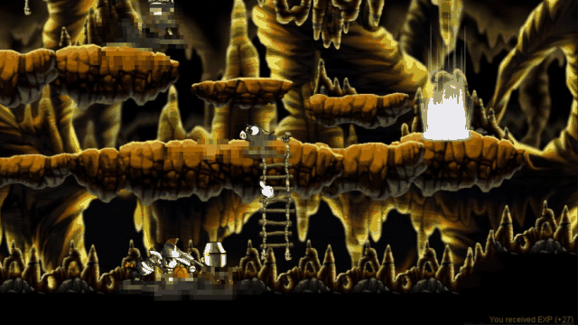
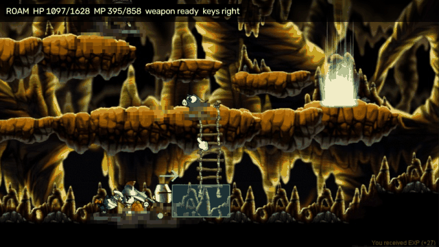
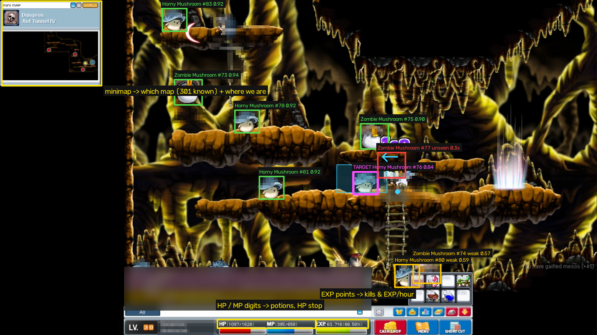
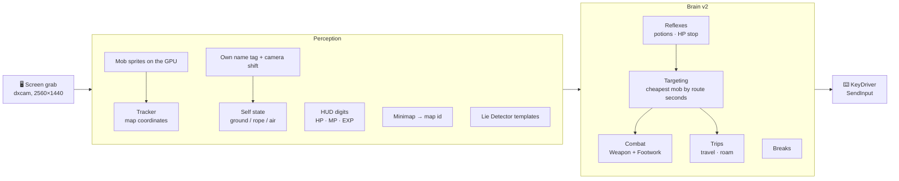

<div align="center">

# 🍄 maple-brain

**A vision-only hunting bot for MapleStory Classic World.**
It looks at the screen, works out where it is and what's around it, and fights with key presses.
It never reads game memory or packets.


<table>
<tr>
<td align="center"><b>What you see</b></td>
<td align="center"><b>What the bot sees</b></td>
</tr>
<tr>
<td></td>
<td></td>
</tr>
<tr>
<td colspan="2" align="center"><sub>Ant Tunnel IV, two kills in 7.5 s of a live run (<code>runs/v2/press1</code>). Player names and chat are pixelated.
<br>Box colours: <b>green</b> = a mob seen this frame (with its match score), <b>magenta</b> = the current target, <b>orange</b> = a weak match,
<b>red</b> = a mob the tracker still believes in but can't see right now (often hidden under hit effects), <b>grey</b> = dying.
The cyan band is the weapon's reach in front of us.</sub></td>
</tr>
</table>

</div>

> [!WARNING]
> Botting breaks Nexon's Terms of Service, and your account can be banned for it. This is a personal research
> project. It is built to run **while you watch it**: it pauses when the game loses focus, stops and beeps on low
> HP, and sounds a siren when the in-game Lie Detector appears. It never answers the Lie Detector itself.

---

## ✨ What it does

| | |
|---|---|
| 🗺️ **Knows the map** | Recognises the current map from the minimap (301 maps), then finds our exact position on the map's own platforms, ropes and ladders |
| 👾 **Finds and tracks mobs** | GPU template matching against every animation frame of the map's mobs, then a tracker that keeps each mob in map coordinates, through hit effects, knockback and camera moves |
| ⚔️ **Fights like a player** | One key press per swing. Swing lengths come from the client files. The next press is decided when the swing ends, with gaps drawn from a recording of a human playing. It turns to mobs behind it and stops swinging once the target is dead |
| 🧗 **Moves around** | Routes across platforms: walks, jumps up, drops down, climbs ropes and ladders. Re-plans when a mob knocks it off course |
| 🧪 **Looks after itself** | Reads the exact HP and MP numbers from the HUD for potions and the HP stop, takes short breaks between fights and longer ones on a safe spot every few minutes |
| 🚨 **Watches for the Lie Detector** | Checks every frame for both Lie Detector windows. It releases every key and sounds a siren until a person deals with it |
| 📊 **Measures itself** | Every run writes `ticks.jsonl` (each tick's observation and actions), saved frames, kills/min, swings per kill, EXP/hour, and a speed line |

## 👁️ How it sees

<p align="center">
  
</p>

Each tick goes through a fixed loop at about 16 fps:



All game knowledge comes from the **game's own client files**, exported once with HaRepacker
(`python -m maplebot assets build`): footholds, ropes, spawns and minimaps for 336 maps; every animation frame,
body box and stat for 117 mobs; weapon attack boxes, stance lengths and attack speeds. There are no hand-drawn maps.

### The live map

`python -m maplebot livemap` draws the running hunt in the console. Here is the tick from the screenshot above:
`@` is us, `M`/`Z` are Horny/Zombie Mushroom tracks with their facing, `?` = unseen right now, `^` = in the air.

```text
10005063 Dungeon - Ant Tunnel IV   x -900..2610  y -540..2220
press1  tick 1077  t=89.6s  mode LOCAL  HP 1097/1628  mobs 11  (Horny Mushroom M, Zombie Mushroom Z)
                                                    #      | .     .     .               |     #
                                                    ===============================      |     #
                                                                                  #  M83>|.    #
                                                                                  # \=========
                                                                                  #      |
                                                                                  #   Z73>^          Z77>^
                                                                                  #   .  |M78>.    M76>
                                                                                  # =\==\/\/==\=\\  Z75>  .
                                                                                  #         .    .=/=.@====.==O
                                                                                  #     .  =M81>==//=====/=//====\\
                                                                                  #   =\==///         H
                                                                                  #                   M80>
                                                                                  M82<? M79>?.      . H Z74<    /=====
                                                                                  =============================//
```

## ⚔️ How it fights

The combat code started from measurements of the game and of a person playing, not from guesses:

- **The game's rules, measured live:** an attack fires on the key-*down*. A press during a swing is ignored, not
  queued. A direction key released before the swing ends is dropped. A polearm swing lasts 0.90 s, which is what
  the client data predicts (`(10 + attackSpeed) / 16 ×` the stance length).
- **The human model:** a keylogged session of the author playing (893 presses, 267 swings) gives the gap after
  each swing, how fast they turn to a mob behind them, and how they stop pressing about 0.3 s into the killing
  swing.
- **The result:** one press per swing, the next one decided when the swing ends. The press goes ahead only if the
  engaged mob is still alive and in reach, so there are no extra swings after a kill.

| Live run | Map | Result |
|---|---|---|
| `runs/v2/press1` (3 min, attack per press, in a party) | Ant Tunnel IV | 13 last-hit kills, 4.5 swings per kill, 0 presses mid-swing |
| `runs/v2/20261105_092129_1` (held attack key) | Kerning Subway Line 1 | **18.2 kills/min** |

## 🚀 Quick start

**You need:** Windows, Python 3.12, an NVIDIA GPU with CUDA PyTorch (for `--gpu`), and the game in windowed mode.
The game runs elevated, so the bot must run from an **admin terminal**. Otherwise Windows silently drops its key
presses.

```powershell
# one-time: build the game data from your own client export (see assets/README.md)
python -m maplebot assets build

# stay loaded: F7 starts a hunt (the map is recognised then), F8 stops it, Ctrl+C quits
python -m maplebot serve runs\v2 --brain v2 --frames

# a timed hunt that saves every 3rd frame
python -m maplebot run runs\v2\my_run --brain v2 --seconds 180 --frames-every 3

# no hunt: only the Lie Detector siren (keep it running between hunts)
python -m maplebot watch runs\watch

# watch a hunt (or replay a recorded one) as a console map
python -m maplebot livemap runs\v2
python -m maplebot livemap runs\v2\press1 --replay

# record yourself playing (the bot presses nothing): keylog + ticks + frames
python -m maplebot serve runs\play --observe --gpu --tracker --frames
```

Every key the bot uses is defined in one place, `Keys` in `maplebot/config.py`.

## 🧪 Tests

```powershell
python -m pytest
```

About 1,100 tests, and none of them need the game: perception checks on real recorded frames, brain scenarios on a
fake clock, movement in a simulator built from the map's footholds, and a **speed check**. Every pytest run ends
with a `bot speed` line. It replays 45 fight frames through the live tick and fails if the bot got more than 25 %
slower than this machine's baseline.

## 🗂️ Layout

| Path | What's there |
|---|---|
| `maplebot/config.py` | every threshold and timing: `Keys`, `Combat`, `Perception`, `Nav`, `Humanize` |
| `maplebot/perception/` | frame → `Observation`: GPU sprites, tracker, camera shift, own tag, HUD digits, Lie Detector |
| `maplebot/nav/` | nav map (platforms, ropes, links, routes), minimap localisation, map identification, self state, simulator |
| `maplebot/brain/` | `brain_v2.py` + `v2/` (reflexes, ledger, scene, breaks, targeting, combat, trips), reach, moves, travel |
| `maplebot/runtime/` | run / serve / watch, the v2 hunt loop, KeyDriver, keylogger, recorder, EXP meter |
| `assets/mcw/` | game data converted from the client export |
| `tests/` | regressions on real frames, behaviour scenarios, the speed baseline |
| `tools/` | analysis and probe scripts (combat, nav, perception, perf, the README pictures) |

## 🛣️ Roadmap

- [x] **M1 movement**: self state, moves, travel, simulator
- [x] **Attack per press**: clean kills, fast turns, swing timing from the client
- [ ] **M2 hunt** (in progress): accuracy (no detections on our own body or pet, HP bars as the kill signal) and
      speed (≥ 30 fps by running perception parts in parallel)
- [ ] **Brain v3** ([PLAN-v3.md](PLAN-v3.md)): a world model and a goal planner on top of today's instincts. Modes:
      **Platform** (hunt only on marked platforms), **Path**, **Auto** (choose spawns by EXP and respawn time)
- [ ] Loot, buffs, skill rotation

Current state and next steps: [HANDOFF.md](HANDOFF.md). Full history: [HISTORY.md](HISTORY.md).

<details>
<summary><b>Regenerating the README pictures</b></summary>

```powershell
python tools\readme\make_images.py runs\v2\press1 87.5 95
```

Builds `docs/img/{play,vision}.gif`, `screen.png` and `livemap.txt` from a recorded run. Every player and pet
name tag, the chat box and the HUD's character name are pixelated. A tag found in one frame is also hidden in the
two frames before and after it, so a tag the finder misses for one frame stays hidden. Check the frames by eye
before you publish new ones.

</details>
